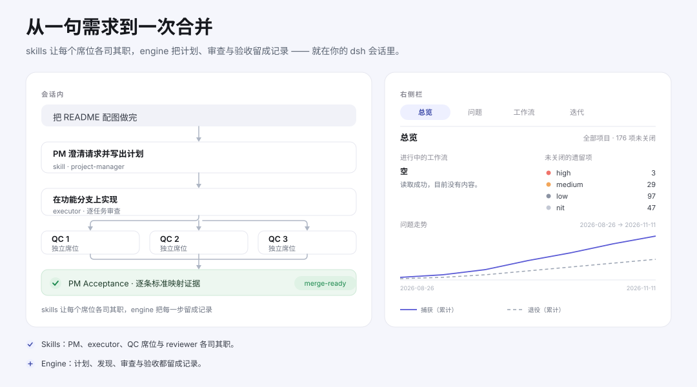

<div align="center">


# [Morning Star](https://github.com/btspoony/mstar-harness)

Harness Workflow Engine · Agent Plugin

[English](README.md) / 中文

<a href="https://github.com/btspoony/mstar-harness">GitHub</a> · <a href="https://github.com/btspoony/mstar-harness/issues">Issues</a>

[](https://github.com/btspoony/mstar-harness/actions/workflows/ci.yml)
[](LICENSE)
[](https://github.com/btspoony/mstar-harness/releases)
[](INSTALL.md#prerequisites)
[](https://github.com/btspoony/mstar-harness/commits/main)
[](https://dshfind.com/zh/plugins/btspoony/mstar-harness?ref=badge)
[](https://www.greptile.com/?utm_source=oss_badge&utm_medium=readme&utm_campaign=greptile_for_open_source)

[](https://www.npmjs.com/package/@mstar-harness/cli)
[](https://www.npmjs.com/package/@mstar-harness/dsh)
[](https://www.npmjs.com/package/@mstar-harness/omp)
[](https://www.npmjs.com/package/@mstar-harness/opencode)

</div>

Morning Star 为你在用的 AI 编程工具带来一套交付流程 —— 支持 dsh、omp、OpenCode、Cursor、Kimi Code、Devin、ZCode 与 Codex。你描述需求，`project-manager` 负责澄清、维护计划，并把工作从需求推进到实现、审查、验收，直到 PR。需求、架构、实现、审查、验收、审计各自有专属角色负责。

**为什么用它**

- **从请求到 PR** —— 描述一次需求即可：PM 维护计划、召集合适的专职角色，并推进到 PR；工作中断时，计划里记录了进度，方便之后继续。
- **由专职角色分工，而不是一段超长 prompt** —— PM 负责编排；需求、架构、实现、QC、验收、审计、运维各有专属角色与明确边界。
- **留下可审计的轨迹** —— 计划、发现、审查报告与决策都记录在仓库的 harness 目录里，而不只是留在对话中。



## 安装

可通过宿主自带的插件管理器安装，或在支持时使用本 CLI 的 `init` 流程；Kimi 与 Devin 仅支持原生安装。原生命令只装插件本身。完整选项、路径布局与各宿主说明见 [`INSTALL.md`](INSTALL.md)。

- **dsh（DeepSeek Harness）** —— 需要 PATH 上有 `dsh` CLI
  - CLI：`npx @mstar-harness/cli init --target dsh`
  - 原生：`dsh plugin --profile web add @mstar-harness/dsh`
- **omp** —— 需要已安装 `omp` CLI
  - CLI：`npx @mstar-harness/cli init --target omp`
  - 原生：`omp plugin install @mstar-harness/omp`
- **OpenCode**
  - CLI：`npx @mstar-harness/cli init --target opencode`
  - 原生：OpenCode 1.x 用 `@mstar-harness/opencode`，2.x 用 `@mstar-harness/opencode-v2`；写入 [`opencode.json`](INSTALL.md#opencode) 的插件列表后重启 OpenCode
- **Cursor** —— 需要 `git`
  - CLI：`npx @mstar-harness/cli init --target cursor`
  - 原生：`git clone https://github.com/btspoony/mstar-harness.git ~/.cursor/plugins/local/morning-star-harness`，然后 **Developer: Reload Window**
- **Kimi Code** —— 无 CLI target
  - 原生：`/plugins install https://github.com/btspoony/mstar-harness`，然后 `/plugins reload`
- **Devin** —— 仅原生安装，无 CLI target
  - 原生：在 **Customize > Plugins** 添加 `btspoony/mstar-harness`，或执行 `devin plugins install btspoony/mstar-harness`
- **ZCode**
  - CLI：`npx @mstar-harness/cli init --target zcode`
  - 原生：ZCode **插件市场 → 添加插件市场**，输入 `https://github.com/btspoony/mstar-harness`，再安装 **morning-star-harness**
- **Codex** —— 需要 `codex` CLI
  - CLI：`npx @mstar-harness/cli init --target codex`
  - 原生：`codex plugin marketplace add btspoony/mstar-harness --ref main`，再执行 `codex plugin add morning-star-harness@mstar-repo`

从既有的 4.x 安装升级是一次经审查的 cutover，而不是安装器的一步；请遵循 [`docs/migration-5.0.md`](docs/migration-5.0.md)。

## 使用

每个会话进入一次 PM，然后用你自己的话描述要做什么；PM 会在该会话中推进整个流程。

| 宿主 | 进入 PM |
|------|---------|
| dsh | `pm` skill |
| omp | `/skill:pm` |
| OpenCode | `Project Manager` agent，或 `/pm` |
| Cursor | `/pm` |
| Kimi Code | 会话自动加载，或 `/skill:pm` |
| Devin | `/morning-star-harness:pm` |
| ZCode | `/morning-star-harness:pm` |
| Codex | `/pm` |

### 单任务（不跑迭代）

给 PM 一个具体的请求，例如：*“给公开 API 加上限流，并补上测试。”* PM 会补全模糊之处、写计划，然后在功能分支上走完 实现 → 独立 QC 审查 → 验收 → 完成。本轮没有修掉的已确认问题会被记录为 issue，而不是丢掉。最终结果由你检查并合并。

### 迭代

| 命令 | 何时 |
|------|------|
| `/iteration-start [direction] [pause]` | Phase 1：通过交互式方向锁定（grill-me）产出本次迭代的 compass 与计划，随后自动推进执行（含分层 PR）、iteration-close 直到 Workflow Close Out。`pause` 停在 Phase 1，稍后用 `/iteration-drive` 继续。 |
| `/iteration-drive` | 恢复或继续推进已锁定的迭代，不接受参数。 |
| `/iteration-loop [direction] [scale]` | 同样的生命周期全程自动，但没有交互阶段。`scale`（`S` / `M` / `L` / `XL`）限制本次迭代承接的 plan 数量。 |

一次迭代只有走完 Workflow Close Out 才算结束：阶段关闭、PR 处于打开状态或 PR 已合并，单独都不算完成。各宿主的命令拼写不同 —— 有的需要插件前缀，Codex 只在 project scope 安装命令 skill；参数形式与各宿主差异见 [`docs/commands.md`](docs/commands.md)。

### 审计、Review 与验证

| 命令 | 何时 |
|------|------|
| `/codebase-audit [keywords]` | 只读盘点，产出按优先级排序、可直接执行的改进计划；按类别聚焦（`bug`、`security`、`perf`、`tech-debt`、…）可缩小范围。 |
| `/codebase-comment-cleanup [path\|subsystem] [dry-run]` | 把每条代码注释归入 删除 / ADR / issue / 保留并定型 四类；按 PR 逐个收紧（ratchet）只读取本次 diff 触及的注释，因此闸门只判定本次变更新增或修改的注释，既有语料保持 advisory。 |
| `/codebase-arch-governance [path\|subsystem] [dry-run] [rounds N]` | 把代码库分闭环批次收敛到其当前需求本应产出的形态：每批只做总复杂度最低的一项改动，迁移全部调用方、删除被替代的实现，并把已确立的规则固化为可执行检查。`dry-run` 只在回复中给出排序后的候选与已观测基线——不建审计运行目录、不写报告/证据文件、不捕获 issue、不写 ADR，也不改代码。`rounds N`（正整数，默认 1）限定一次调用可完成的闭环批次数。 |
| `/amazing-pr-review [pr\|branch] [quick\|default\|deep]` | 合并前审查 PR 或分支，三档强度，最终给出唯一结论：settled（无中断完成、必需领域全部打开、已解析的 diff basis 可读且完整）的 run 按 finding tally 给出 `ship it`、`needs fixes` 或 `blocked`；仅在三种情况下给出唯一派生的 `incomplete`：run 在综合之前被中止，必需领域从未打开，或已解析的 diff basis 不可读。超过 wall clock 预算不属于这三种情况：完整覆盖的 run 即使超时，仍按 tally 给出结论，并把超时作为 note 声明。 |
| `/amazing-test-audit [scope] [quick\|deep] [campaign]` | 对测试面做只读审计 → 产出删除、修复、合并或迁移测试的计划。 |
| `/amazing-e2e-check [environment] [scenarios]` | 在独立 workflow 中运行你明确要求的浏览器、真机或安装部署场景。 |

审计类入口只读取并报告，不改你的代码——`/codebase-arch-governance` 是例外：默认在常规 plan 门禁下执行闭环批次，`dry-run` 只报告。有两条边界要知道：`/amazing-pr-review` 在你给出 PR 编号时会把发现以 comment review 发布到 GitHub —— 它从不 approve、request changes 或 merge；`/amazing-e2e-check` 只在你主动要求时运行，其中触及真实环境的步骤需要明确授权。

## 工作流


交互版是 `assets/workflow.zh.html`；GitHub 只显示源码，请在本地打开。层 PR 与执行并行；只有 close-delta 层依赖 close；所有必需层合并后整链证明，最后 Workflow Close Out。

**development** 交付让每个 plan 走完 plan 级 QC —— 默认三个独立席位，多任务 plan 加 per-task review，hotfix/inline 用较轻规则 —— 再由 **PM Acceptance** 唯一验收：每条标准映射到真实证据，QC 批准本身不是证明。已确认但未修复的问题仍作为 issue 跟踪。

迭代先与你锁定方向，对承接的每个 plan 跑一遍上述循环，执行期间按层发布 PR，最后统一收尾；不跑迭代时只为一个 plan 执行。验证或 report-only 交付物在约定完成条件时结束，没有 PR 或合并。plan 完成、merge-ready 与已合并是三件不同的事：只有核实合并并走完 Workflow Close Out，交付才结束。是否合并是单独的授权 —— `owner-gated`、`reviewed-auto`（当前 head 上有 settled、已 posted 的 `ship it`）或 `reviewed-bot`（挂载 bot 在该 head 上最新一次过门 review；未记录 policy 会回到 Phase 1）。分支清理是收尾之后的显式动作。

引擎校验可机械校验的部分：状态流转、分支与 worktree 对齐、派发前置条件、plan 与 issue 记录。默认 advisory，除非设置 `enforcement: hard`。过程状态存放在 `.mstar/`，由 scaffold 的规范 `.gitignore` 片段忽略；安装器不改动 `.gitignore`。

## Dashboard：本地看板

只在本机 `127.0.0.1` 上提供的只读页面：在同一个界面里查看项目进展、未解决问题和路线图，对应你启动它时所在的仓库。页面有 Issues、Workflows、Iterations 和 Roadmap；在 Issues 中可以搜索和筛选、打开单条 issue 的已记录历史，并查看 issue 走势 —— 捕获与退役（captured vs retired）的累计趋势。页面本身不写入；修改通过 CLI 完成。

```text
mstar-harness dashboard
```

命令打印一行 JSON。打开其中的 `data.url`（`http://127.0.0.1:` 加上它实际绑定的端口），按 Ctrl-C 停止。`--port` 和 `--project <projectId>` 都是可选的；省略 `--port` 时由操作系统选择端口。页面不会推送实时更新。

细节见 [`docs/runtime-reference.md`](docs/runtime-reference.md#cli-contract)。

## MCP

在支持 MCP 的编程工具中，可以查看 issue、roadmap 和 workflow，并调用对应的 CLI 操作与检查，而不必编写 shell 命令。`mstar-harness mcp` 是本包中的 stdio 服务。它遵守与 CLI 相同的规则 —— 不是一项新权限 —— 也没有单独的 MCP 包。

安装之后，宿主通常已经带有启动配置，见 [`INSTALL.md`](INSTALL.md#installing-the-mcp-tools)。带静态 JSON 配置的宿主使用下面这种形式（`npx` 使用 PATH 上的 Node 执行该 bin，见 [安装前置要求](INSTALL.md#prerequisites)）。不要把它粘贴到宿主已经写好的文件上。OpenCode 不读取静态文件 —— 它的插件通过 `config` hook 注入该服务。dsh 是例外：自带的配置行在 profile 包含 `@deepseek-ai/dsh-mcp-client` 之前不会生效（`dsh plugin --profile web add @deepseek-ai/dsh-mcp-client`）。

```json
{
  "mcpServers": {
    "morning-star": {
      "command": "npx",
      "args": ["@mstar-harness/cli", "mcp"]
    }
  }
}
```

命令细节见 [`docs/runtime-reference.md`](docs/runtime-reference.md#mcp)。

## 角色与技能

| Agent ID | 职责 |
|----------|------|
| `project-manager` | 路由、分派、阶段推进、证据驱动的 PM Acceptance 与唯一 Done 签署 |
| `product-manager` | 需求、产品规划、研究 |
| `architect` | 架构与技术契约 |
| `fullstack-dev` / `fullstack-dev-2` | 后端主导实现 / 第二并行轨 |
| `frontend-dev` | UI、交互、前端性能 |
| `code-reviewer` | SDD per-task 快速验证；codebase audit（`audit` 类） |
| `qc-specialist` / `-2` / `-3` | QC 三审 |
| `ops-engineer` | 部署、监控、基础设施 |
| `writing-specialist` | 文档、小说、文案、脚本 |
| `prompt-engineer` | prompt / skill / rule |

**project-manager** 在你的会话中运行并负责验收，将需求与架构、实现、独立审查、审计、运维和写作派给对应专业角色。每个角色遵循 `mstar-*` skills。验收流程见 [`mstar-roles/references/project-manager/acceptance.md`](skills/mstar-roles/references/project-manager/acceptance.md)。

## 命令行

`mstar-harness` CLI 覆盖会话之外的事务：issue、roadmap、工作流状态、各类校验、看板与 MCP。

- **直接问命令本身。** `--help` 会列出命令期望的输入；对 issue 的写操作，它还会逐条列出 payload 字段的类型，以及必填还是仅在特定处置方式下必填。用法被拒绝时，它会说明发现的问题、该看哪条 help，以及如何恢复。

```text
mstar-harness --help                        # 命令族
mstar-harness issue close --help            # 单个动词的选项与 payload 字段
mstar-harness schema --command issue.close  # 同一份契约的机器可读 JSON
```

- `mstar-harness report` 生成离线、脱敏的 GitHub issue 报告草稿，供你检查后再提交。

宿主接入、issue 与 roadmap 命令族，以及这些界面背后的细节，见 [`docs/runtime-reference.md`](docs/runtime-reference.md)。

## 文档

- [`docs/runtime-reference.md`](docs/runtime-reference.md) —— 组件、存储布局、角色与技能、CLI 与 MCP 参考。
- [`INSTALL.md`](INSTALL.md) —— 各宿主的安装与校验，以及 `report` 命令的完整说明。
- [`docs/commands.md`](docs/commands.md) —— 九条斜杠命令：参数、适用场景、归属 skill。
- [`docs/migration-5.0.md`](docs/migration-5.0.md) —— 从 4.9.x 升级到 5.0 协作权威：有哪些破坏性变更、cutover 阶梯，以及拒绝后的恢复。
- [`CONCEPTS.md`](CONCEPTS.md) —— harness 在 skills 与文档中使用的术语表。
- 更新说明：[`CHANGELOG.md`](CHANGELOG.md) / [`CHANGELOG_CN.md`](CHANGELOG_CN.md)。CLI 参数：**`mstar-use-cli`** skill。
- 维护者：[`AGENTS.md`](AGENTS.md)。

## 许可

MIT，见 [LICENSE](./LICENSE)。
