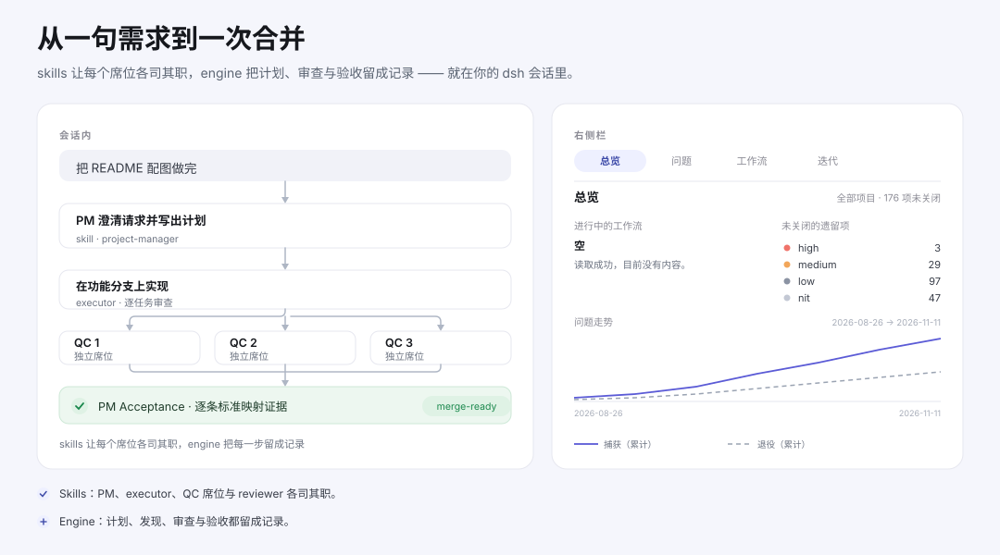

Morning Star Harness 给 dsh 会话的是一套交付流程，而不是一段提示词：PM skill 写出计划，独立 QC 席位与 reviewer 审查，executor 在功能分支上实现，PM Acceptance 在交付进入 merge-ready 之前把每条标准映射到证据。插件把这份记录留在会话里 —— `agent/pre-step` 的模型可见 `mstar-engine` 行与工具调用上的三个原生门禁 —— 也留在右侧栏：「晨星工作流」面板从 CLI 写入的同一份工作区状态里列出未关闭项、问题走势与迭代进度。
